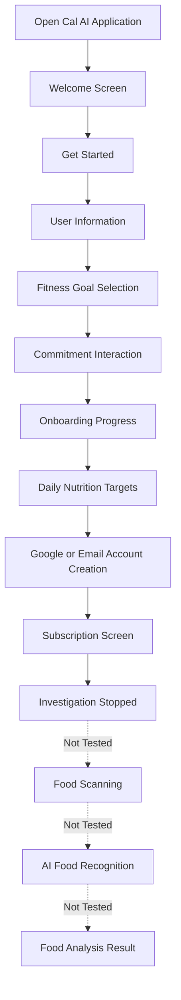

# SVL-01 – Reference App Investigation and User Journey

**Project:** Indian Food Recognition & Nutrition App  
**Reference Application:** Cal AI  
**Investigation Type:** Manual User Experience Observation  
**Status:** Partially Completed

---

## 1. Objective

The objective of this investigation is to understand how the Cal AI application works from a user's perspective.

The investigation focuses on understanding the onboarding process, information collected from users, account creation, subscription flow, and the overall expected food-scanning journey.

The purpose is to identify useful features, possible usability improvements, and opportunities to build a better food recognition and nutrition tracking experience for Indian users.

## 2. Reference Application

**Application Name:** Cal AI

**Application Website:** https://www.calai.app/

Cal AI is a food and calorie-tracking application designed to help users understand their food intake and manage their nutrition.

The investigation was conducted through authorized, user-visible application functionality. No private data, proprietary code, or restricted functionality was accessed.

## 3. Investigation Method

The following activities were included in the manual investigation:

1. Accessed the reference application.
2. Started the onboarding process.
3. Observed the questions asked during user setup.
4. Recorded the personal information and fitness goals requested.
5. Observed the calorie and nutrition targets displayed during setup.
6. Continued through the account creation process.
7. Reached the subscription screen.
8. Stopped the investigation without purchasing a subscription.

**Investigation limitation:** The investigation was completed only up to the subscription screen. The post-subscription food-scanning and analysis journey could not be directly tested.

## 4. Observed User Journey

The following steps represent the onboarding journey directly observed during the investigation.

### Step 1: Welcome Screen

- The application displays a welcome screen.
- A Get Started option allows users to begin the onboarding process.
- The onboarding process collects information to understand the user's profile and goals.

**Observation Status:** Directly Observed

### Step 2: User Information Collection

During onboarding, the application asks users for information such as:

- Gender
- Weekly workout frequency
- Height
- Weight
- Date of birth (DOB)
- Whether the user has previously used a calorie-tracking application
- How the user discovered the application

**Observation Status:** Directly Observed

### Step 3: Fitness Goal Selection

- The application collects information about the user's fitness goals.
- Users are guided through questions related to their desired fitness outcomes.
- A commitment interaction using a tap-and-hold action is also presented during setup.

**Observation Status:** Directly Observed

### Step 4: Onboarding Progress and Nutrition Targets

- The application displays progress during the setup process.
- After collecting user information, it displays personalized daily nutrition targets.
- The observed nutrition information includes:
  - Daily calorie target
  - Protein target
  - Carbohydrate target
  - Fat target

**Observation Status:** Directly Observed

### Step 5: Account Creation

The application provides account creation options.

The observed options include:

- Continue with Google
- Continue with Email

**Observation Status:** Directly Observed

### Step 6: Subscription Screen

- After the onboarding and account creation flow, the application reaches a subscription screen.
- The subscription screen is part of the observed user journey.
- No subscription was purchased during the investigation.

**Observation Status:** Directly Observed

### Step 7: Food Scanning and Nutrition Analysis

The investigation stopped at the subscription screen.

Therefore, the following activities were not directly tested:

- Opening the food scanner
- Capturing or uploading a food image
- AI-based food recognition
- Viewing calorie and nutrition results
- Editing detected food items
- Adjusting portion sizes

**Observation Status:** Not Tested

## 5. User Journey Workflow 

The following workflow represents the directly observed onboarding journey and clearly marks the point where the investigation stopped.

**Note:** The dashed workflow represents functionality that was not tested. It should not be interpreted as a verified Cal AI user journey.

## 6. Information Displayed to Users

The following table summarizes the information and functionality observed during onboarding.

| Feature | Observed Information | Status |
|---|---|---|
| Welcome Screen | Get Started option | Observed |
| User Profile | Gender, height, weight, DOB | Observed |
| Activity Information | Weekly workout frequency | Observed |
| Previous App Usage | Previous calorie-app usage | Observed |
| Fitness Goals | Goal-related questions | Observed |
| Daily Nutrition | Calories, protein, carbohydrates, fats | Observed |
| Account Creation | Google and Email options | Observed |
| Subscription | Subscription screen | Observed |
| Food Scanning | Camera or gallery scanning | Not Tested |
| Food Recognition | Detected food names | Not Tested |
| Nutrition Results | Food calories and macros | Not Tested |
| Food Editing | Correcting detected food or quantity | Not Tested |

## 7. Food Scanning and Analysis – Untested Areas

The following features were identified as important investigation areas but could not be verified because the investigation stopped at the subscription screen.

| Investigation Area | What Needs to Be Checked | Status |
|---|---|---|
| Food Image Input | Whether users can capture or upload food images | Not Tested |
| Food Recognition | Whether the application identifies food correctly | Not Tested |
| Mixed Meals | Whether multiple food items on one plate are identified separately | Not Tested |
| Ambiguous Images | How the application handles unclear or blurry images | Not Tested |
| Incorrect Predictions | Whether users can correct incorrect food predictions | Not Tested |
| Portion Estimation | Whether serving size or food quantity can be adjusted | Not Tested |
| Nutrition Results | Whether calories, protein, carbs, and fats are displayed | Not Tested |
| Food Tracking | Whether scanned food can be added to a daily food diary | Not Tested |

These are unanswered investigation questions, not confirmed limitations of Cal AI.

## 8. Product Observations and Improvement Opportunities

The following points combine direct onboarding observations with proposed improvements for our Indian Food Recognition & Nutrition App.

| No. | Observation / Opportunity | Proposed Improvement |
|---|---|---|
| 1 | The application collects multiple personal details during onboarding. | Keep onboarding simple and ask only essential questions. |
| 2 | The application collects fitness goals and activity information. | Provide clear and understandable fitness goal options. |
| 3 | Daily calories and macronutrient targets are displayed during setup. | Show calories, protein, carbohydrates, and fats clearly on the dashboard. |
| 4 | Users are guided through multiple onboarding steps. | Make the onboarding process short and easy to complete. |
| 5 | The observed nutrition targets are useful for tracking food intake. | Provide nutrition information relevant to common Indian meals. |
| 6 | Indian meals may contain several food items on a single plate. | Support mixed-meal recognition, such as Roti, Dal, Rice, and Sabzi. |
| 7 | Indian food includes many regional dishes. | Support foods such as Poha, Dosa, Idli, Samosa, Paratha, and other regional dishes. |
| 8 | Food recognition systems can produce uncertain predictions. | Provide a confirmation or correction option when food recognition is uncertain. |
| 9 | Portion size affects nutrition calculations. | Allow users to adjust food quantity or serving size. |

**Important distinction:** Points 1–5 are based on the observed onboarding experience and proposed improvements. Points 6–9 are product opportunities for our application, not verified weaknesses of Cal AI.

## 9. Useful Features Identified

Based on the directly observed onboarding process, the following features are useful references for our application:

1. **Simple Welcome Experience:** A clear starting point helps users begin using the application.
2. **Personalized User Setup:** Collecting height, weight, age, and activity information can help personalize nutrition targets.
3. **Fitness Goal Selection:** Users should be able to select their desired fitness goal.
4. **Daily Nutrition Targets:** Showing calorie and macronutrient targets helps users understand their daily requirements.
5. **Account Creation Options:** Providing Google and Email options gives users account access choices.

These are features observed during onboarding. Food-scanning features have not been verified.

## 10. Evidence and Screenshots

Screenshots or handwritten investigation notes should be attached as evidence of the authorized observations.

Add the available evidence in the following sections:

| Evidence | Description | Link |
|---|---|---|
| Evidence 1 | Welcome and Get Started Screen | [Add Screenshot Link] |
| Evidence 2 | User Information Questions | [Add Screenshot Link] |
| Evidence 3 | Fitness Goal Selection | [Add Screenshot Link] |
| Evidence 4 | Daily Nutrition Targets | [Add Screenshot Link] |
| Evidence 5 | Account Creation Screen | [Add Screenshot Link] |
| Evidence 6 | Subscription Screen | [Add Screenshot Link] |

**Evidence Note:** Only actual screenshots or genuine investigation notes should be added. Do not use design references as proof of direct application observations.

## 11. Unanswered Questions

The following questions remain open because the food-scanning journey was not accessible during this investigation:

1. Does the application allow users to scan food using a camera and upload images from a gallery?
2. How accurately does it recognize Indian food items?
3. Can it identify multiple food items from a single Indian Thali image?
4. How does it handle blurry images or food items that look similar?
5. Does it allow users to edit an incorrectly detected food item?
6. Can users change the estimated portion size?
7. How are calories, protein, carbohydrates, and fats calculated?
8. Does it provide a daily food diary and nutrition history?
9. What happens when the application cannot recognize a food item?

These questions should be investigated only when the relevant functionality is available through authorized access.

## 12. Investigation Limitations

- The investigation was limited to user-visible functionality.
- The onboarding process was observed up to the subscription screen.
- No subscription was purchased.
- Food scanning and post-subscription functionality were not tested.
- No assumptions about untested features are presented as direct observations.
- No proprietary code, private data, or restricted application functionality was accessed.

## 13. Conclusion

The manual investigation helped understand the initial user journey of Cal AI, including its welcome screen, user information collection, fitness goal selection, personalized daily nutrition targets, account creation, and subscription screen.

The investigation also identified useful onboarding features and several opportunities to improve the user experience for Indian users.

For our Indian Food Recognition & Nutrition App, the key opportunities include supporting regional Indian dishes, recognizing multiple food items in a single meal, displaying clear nutrition information, and allowing users to correct food predictions and adjust portion sizes.

The food-scanning and nutrition-analysis journey of Cal AI remains untested and should be investigated separately if authorized access becomes available.

**Final Status:** Partially Completed – Onboarding observed up to the subscription screen; food-scanning journey not tested.
