## SVL-02 - Investigate the Technical Approach (01)

##  Technology Used-

- **Programming Language:** Python
- **IDE:** Visual Studio Code
- **AI Model:** Gemini 3.5 Flash
- **Platform:** Google AI Studio
- **Backend:** Flask
- **API:** Google Gemini API

## Working Approach-

1. A food image is uploaded to the Python application.
2. The image is sent to the Gemini API.
3. Gemini analyzes the food image.
4. The API identifies the food name, ingredients, cooking method, portion size, and other details.
5. The generated result is displayed for testing.

## Practical Testing-

Five different Indian food images were tested using the Gemini API.

### Test 1: Masala Dosa

#### 1. Original Food Image

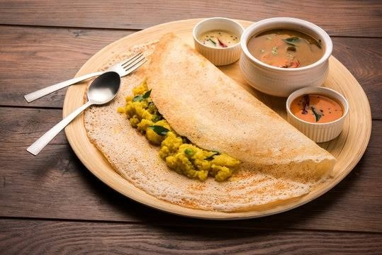

#### 2. Tested Image Result

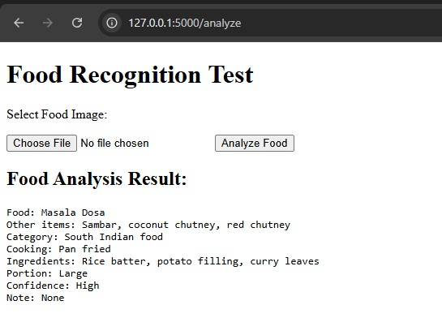

#### 3. Analysis Details

- **Food Name:** Masala Dosa
- **Other Items:** Sambar, coconut chutney, red chutney
- **Category:** South Indian Food
- **Cooking Method:** Pan-fried
- **Ingredients:** Rice batter, potato filling, curry leaves
- **Portion Size:** Large
- **Confidence:** High
- **Note:** None

### Test 2: South Indian Thali

#### 1. Original Food Image

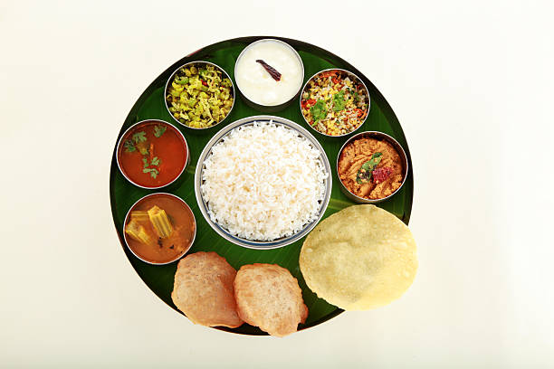

#### 2. Tested Image Result

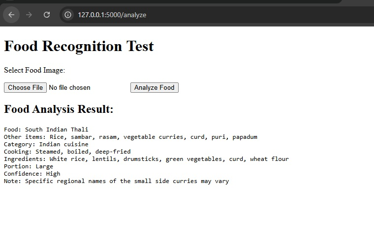

#### 3. Analysis Details

- **Food Name:** South Indian Thali
- **Other Items:** Rice, sambar, rasam, vegetable curries, curd, puri, papadum
- **Category:** Indian Cuisine
- **Cooking Method:** Steamed, boiled, deep-fried
- **Ingredients:** White rice, lentils, drumsticks, green vegetables, curd, wheat flour
- **Portion Size:** Large
- **Confidence:** High
- **Note:** Small side curries' regional names may vary.

### Test 3: Poori

#### 1. Original Food Image

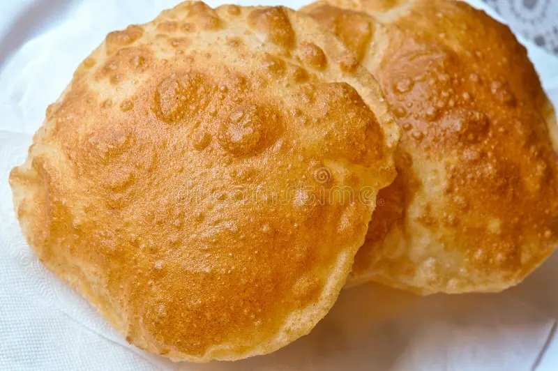

#### 2. Tested Image Result

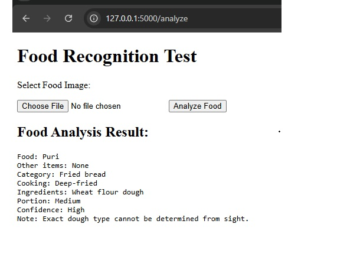

#### 3. Analysis Details

- **Food Name:** Poori
- **Other Items:** None
- **Category:** Fried Bread
- **Cooking Method:** Deep-fried
- **Ingredients:** Wheat flour dough
- **Portion Size:** Medium
- **Confidence:** High
- **Note:** Exact dough type cannot be determined from sight.

### Test 4: Poha

#### 1. Original Food Image

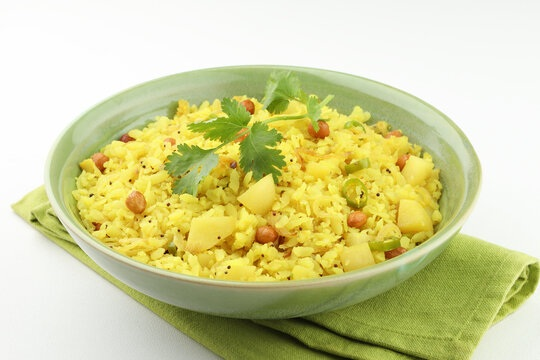

#### 2. Tested Image Result

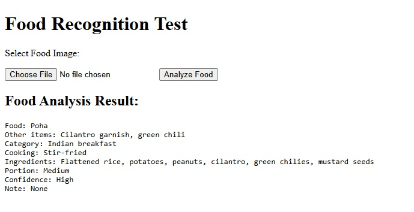

#### 3. Analysis Details

- **Food Name:** Poha
- **Other Items:** Cilantro garnish, green chilies
- **Category:** Indian Breakfast
- **Cooking Method:** Stir-fried
- **Ingredients:** Flattened rice, potatoes, peanuts, cilantro, green chilies, mustard seeds
- **Portion Size:** Medium
- **Confidence:** High
- **Note:** None

### Test 5: Samosa

#### 1. Original Food Image

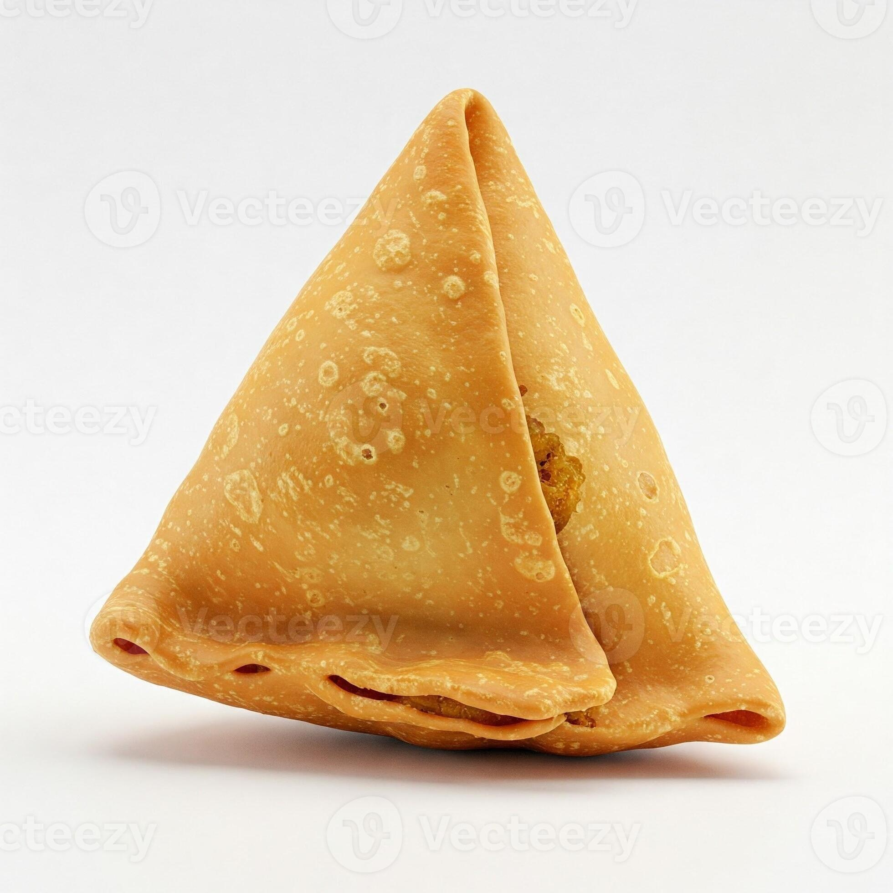

#### 2. Tested Image Result

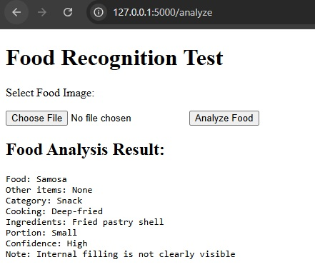

#### 3. Analysis Details

- **Food Name:** Samosa
- **Other Items:** None
- **Category:** Snack
- **Cooking Method:** Deep-fried
- **Ingredients:** Fried pastry shell
- **Portion Size:** Small
- **Confidence:** High
- **Note:** Internal filling is not clearly visible.

## Model Selection Evidence

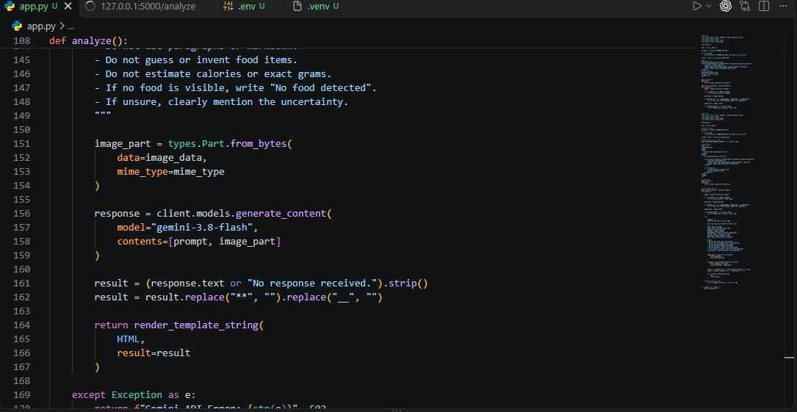

## Testing Summary-

- A total of 5 Indian food images were tested.
- The API successfully identified the main food items.
- It also detected ingredients, cooking methods, and portion sizes.
- Some details, such as hidden fillings and exact regional ingredients, may not be identified accurately.

## Technical Feasibility-

The Gemini API approach is technically feasible for Indian food recognition.

- Python can be used to connect the application with the Gemini API.
- Flask can handle image uploads and API requests.
- The model can analyze different Indian food images.
- The approach can be integrated into a food recognition application.

## References and Sources-

- Google AI Studio: https://aistudio.google.com/
- Gemini API Documentation: https://ai.google.dev/gemini-api/docs
- Google GenAI Python SDK: https://github.com/googleapis/python-genai
