# SVL-02 – Investigate the Technical Approach

## 1. Technology Used

- **Programming Language:** Python
- **IDE:** Visual Studio Code
- **AI Model:** Gemini 3.5 Flash (as recorded in testing evidence)
- **Platform:** Google AI Studio
- **Backend:** Flask
- **API:** Google Gemini API
- **Python SDK:** Google GenAI SDK

## 2. Working Approach

The food recognition process follows these steps:

1. A food image is uploaded to the Python application.
2. Flask receives the uploaded image.
3. The application validates the image format and file size.
4. The image is sent to the Gemini API.
5. Gemini analyzes the food image.
6. The API identifies the food name, visible ingredients, cooking method, portion size, and other details.
7. The generated result is displayed on the application for testing.

## 3. Practical API Testing

Tested five different Indian food images and one blurry food image as an edge case.

### Test 1: Masala Dosa

#### 1. Original Food Image

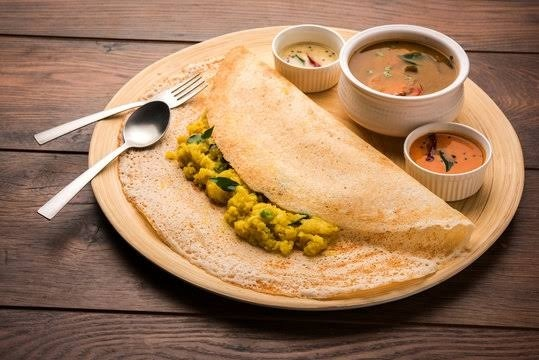

#### 2. Tested Image Result

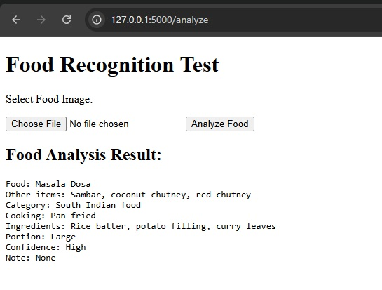

#### 3. Analysis Details

- **Food Name:** Masala Dosa
- **Other Items:** Sambar, coconut chutney, red chutney
- **Category:** South Indian Food
- **Cooking Method:** Pan-fried
- **Ingredients:** Rice batter, potato filling, curry leaves
- **Portion Size:** Large
- **Confidence:** High
- **Note:** None
**Masala Dosa:** [Freepik](https://www.freepik.com/)
### Test 2: South Indian Thali

#### 1. Original Food Image

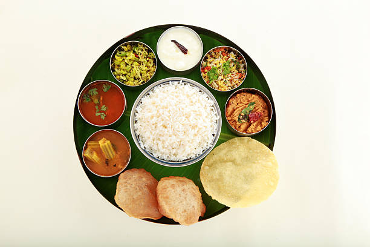

#### 2. Tested Image Result

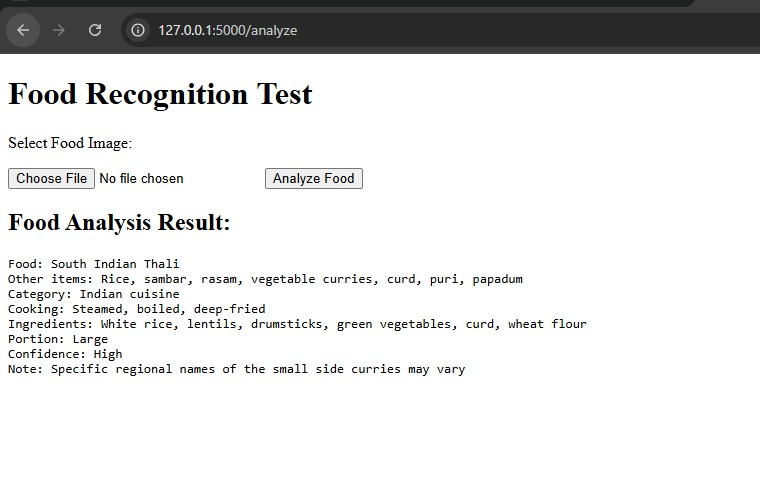

#### 3. Analysis Details

- **Food Name:** South Indian Thali
- **Other Items:** Rice, sambar, rasam, vegetable curries, curd, puri, papadum
- **Category:** Indian Cuisine
- **Cooking Method:** Steamed, boiled, deep-fried
- **Ingredients:** White rice, lentils, drumsticks, green vegetables, curd, wheat flour
- **Portion Size:** Large
- **Confidence:** High
- **Note:** Small side curries' regional names may vary.

 **South Indian Thali:** [iStock](https://www.istockphoto.com/)
  
### Test 3: Poori

#### 1. Original Food Image

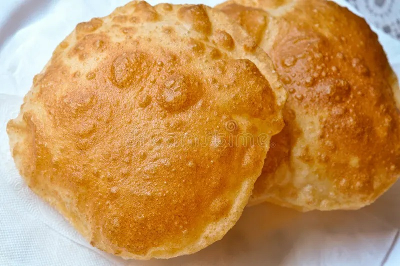

#### 2. Tested Image Result

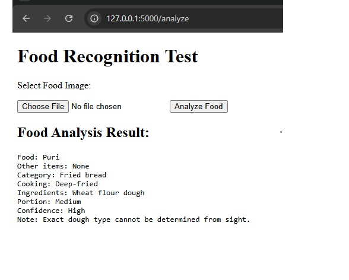

#### 3. Analysis Details

- **Food Name:** Poori
- **Other Items:** None
- **Category:** Fried Bread
- **Cooking Method:** Deep-fried
- **Ingredients:** Wheat flour dough
- **Portion Size:** Medium
- **Confidence:** High
- **Note:** Exact dough type cannot be determined from sight.
 **Poori:** [Dreamstime](https://www.dreamstime.com/)
### Test 4: Poha

#### 1. Original Food Image

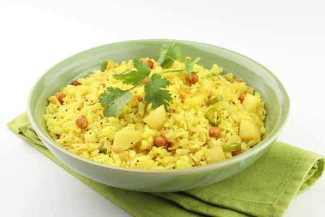

#### 2. Tested Image Result

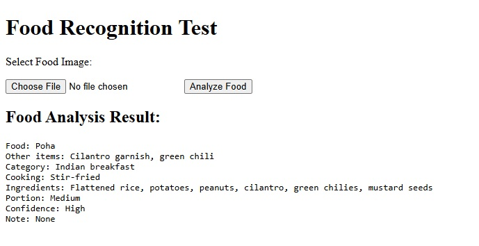

#### 3. Analysis Details

- **Food Name:** Poha
- **Other Items:** Cilantro garnish, green chilies
- **Category:** Indian Breakfast
- **Cooking Method:** Stir-fried
- **Ingredients:** Flattened rice, potatoes, peanuts, cilantro, green chilies, mustard seeds
- **Portion Size:** Medium
- **Confidence:** High
- **Note:** None
 **Poha:** [Freepik](https://www.freepik.com/)
### Test 5: Samosa

#### 1. Original Food Image

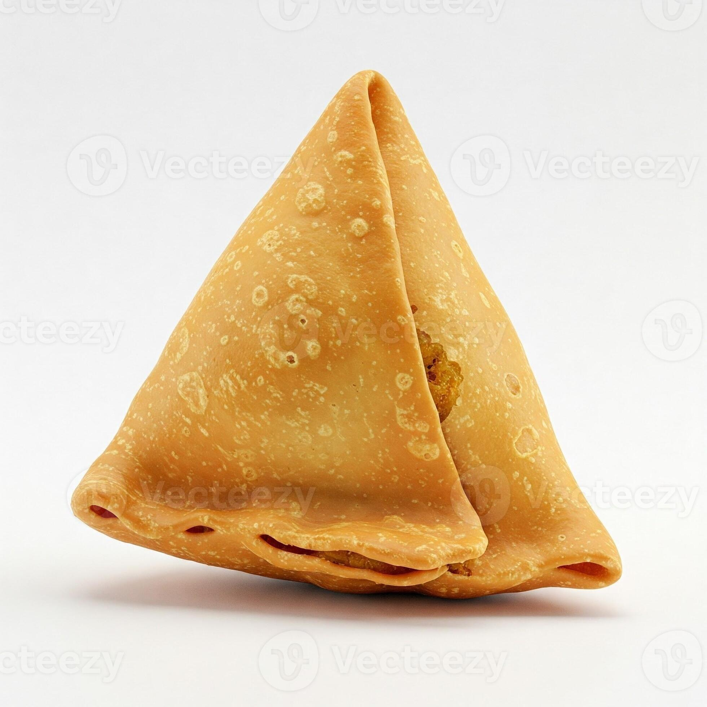

#### 2. Tested Image Result

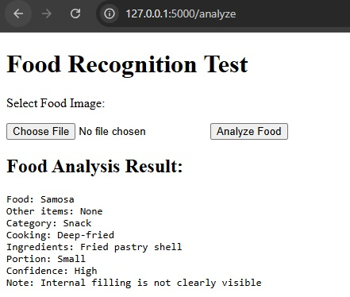

#### 3. Analysis Details

- **Food Name:** Samosa
- **Other Items:** None
- **Category:** Snack
- **Cooking Method:** Deep-fried
- **Ingredients:** Fried pastry shell
- **Portion Size:** Small
- **Confidence:** High
- **Note:** Internal filling is not clearly visible.
- **Samosa:** [Vecteezy](https://www.vecteezy.com/)
  
### Test 6: Blurry Food

#### 1. Original Food Image

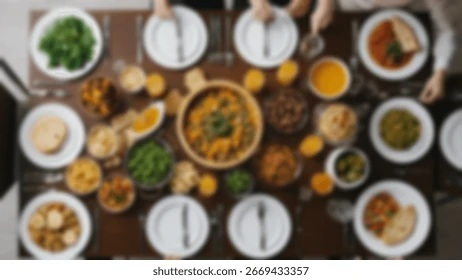

#### 2. Tested Image Result

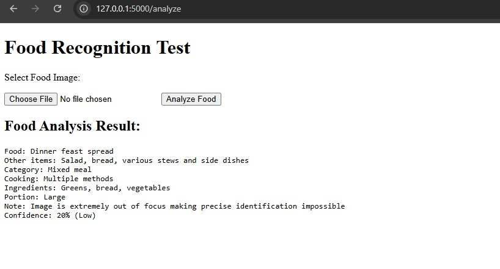

#### 3. Analysis Details

- **Food:** Dinner feast spread
- **Other items:** Salad, bread, various stews and side dishes
- **Category:** Mixed meal
- **Cooking:** Multiple methods
- **Ingredients:** Greens, bread, vegetables
- **Portion:** Large
- **Confidence:** 20% (Low)
- **Note:** Image is extremely out of focus making precise identification impossible

6. **Blurry Food Image:** [Shutterstock](https://www.shutterstock.com/)
   
## 4. Model Selection Evidence

The following screenshot records the Gemini model selection used during testing.

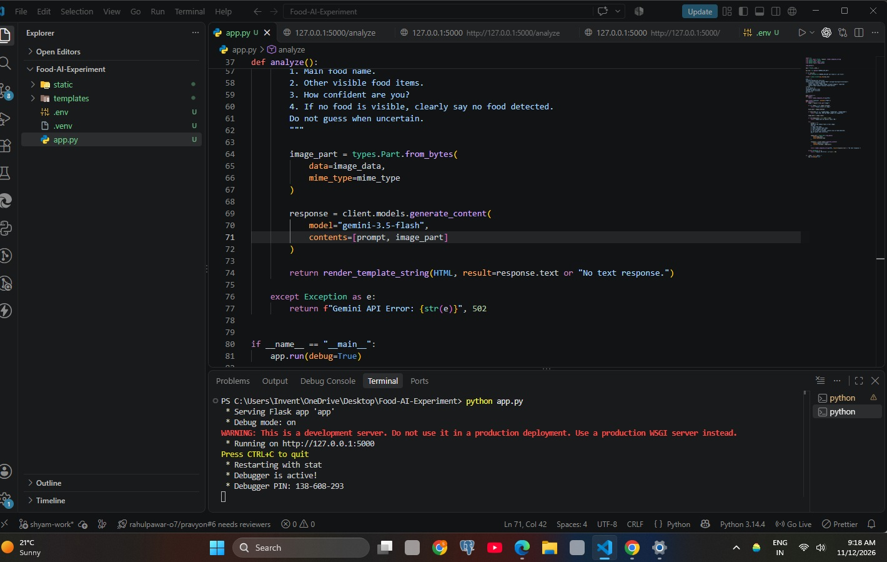

## 5. Testing Summary

- Selected the Gemini model recorded in the testing evidence.
- Generated and configured the Gemini API key.
- Integrated the Gemini API with Python.
- Used Flask for backend setup.
- Tested five different Indian food images.
- Recorded the API-generated food analysis results.
- Reviewed the model's identification and confidence output.

## 6. Observed Limitations and Edge Cases

The testing results also show some limitations:

1. **Mixed Indian Thali:** Small side curries may be difficult to identify by their exact regional names.
2. **Poori:** The exact type of dough or flour cannot be confirmed from the food image alone.
3. **Samosa:** The internal filling cannot always be identified when it is not visible.
4. **Ingredient Identification:** Some ingredients may be difficult to distinguish when multiple food items are mixed together.

**Confidence Observation:**

The five Indian food tests returned "Confidence: High". The blurry food test returned "Confidence: 20% (Low)". This does not necessarily mean that every identified ingredient or detail was completely accurate. The limitations above show why visual recognition results should be checked rather than treated as guaranteed facts.

one low-confidence API result is claimed in this report because none was recorded in the five tests.

## 7. Technical Feasibility

The Gemini API approach is technically feasible for testing Indian food recognition.

- Python can connect the application with the Gemini API.
- Flask can handle image uploads and API requests.
- The model can analyze different Indian food images.
- The approach can be integrated into a food recognition application.
- Further testing is required for complex dishes, hidden ingredients, and visually similar foods.

## 8. References and Sources

- Google AI Studio: https://aistudio.google.com/
- Gemini API Documentation: https://ai.google.dev/gemini-api/docs
- Google GenAI Python SDK: https://github.com/googleapis/python-genai

**Evidence Location:** `docs/research/evidence/technical-food-testing/`

**Documentation Status:** SVL-02 technical testing and practical observations.
